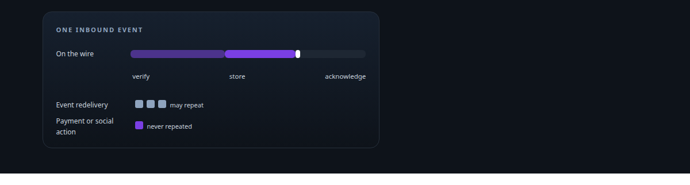
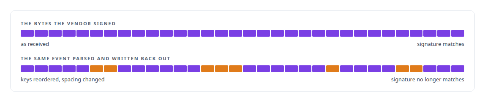
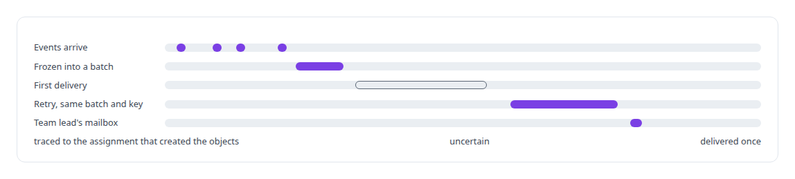
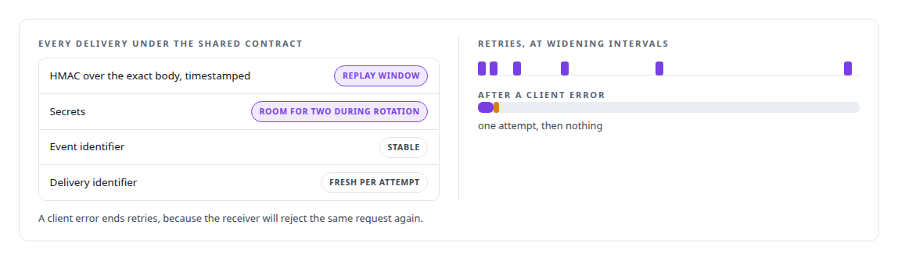
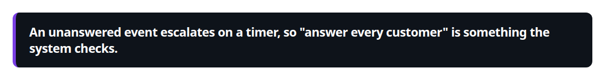

# Webhook ingestion and verification

**Inbound vendor events are signature-checked, batched durably and delivered to the team that caused them, in the gateway and in the in-house social integrations.**

Canonical: https://coreyjames.ai/technologies/webhook-ingestion-and-verification/  
Author: Corey James · Published: 2026-10-28 · Kind: technology  
Systems: [FAFOHive](https://github.com/coreyjames-ai/fafohive) · [FAFO Core and Function Forge](https://github.com/coreyjames-ai/fafo-core)  
Skills: [distributed systems correctness](https://github.com/coreyjames-ai/portfolio/tree/main/skills/distributed-systems-correctness)  



## Result

| Figure | What it measures |
| --- | --- |
| **300 s** | replay window on every signed delivery |
| **6** | attempts at most, at widening intervals, on network and server errors only |
| **5 min** | between checks for events left unanswered past their deadline |

## What was built

### Three rules in both event planes

[FAFOHive](https://coreyjames.ai/systems/fafohive) receives webhooks in two event planes, and I set the same three rules for both: check the signature over the untouched body, store before acknowledging, and keep event redelivery separate from action repetition. Signatures are checked over raw bytes, because re-serialised JSON no longer matches. Events may be redelivered; payment and social actions are never repeated.



The platforms define their webhook formats; the receivers, the shared contract, the listener and the delivery semantics are mine. [FAFO Core and Function Forge](https://coreyjames.ai/systems/fafo-core) has a sibling platform that puts third-party APIs behind generic MCP servers, and webhook ingestion keeps its local copy of each vendor's data current between calls.

### Business events to the team that caused them

The first plane carries business events from the payments, email/CRM and social-publishing providers that governed agent teams use. Each provider and environment has its own endpoint. The receiver checks the vendor's signature over the raw request body before parsing, stores the event, and only then answers success.

It finds the governed assignment that caused the event from the business objects that assignment created, freezes events into delivery batches with stable keys, and hands each batch to the owning team lead's mailbox once. An uncertain delivery is retried with the same batch and key. See [Agents with real tools and no keys](https://coreyjames.ai/stories/agents-with-real-tools-and-no-keys).



### Every mention answered

The second plane serves my X, Facebook and Reddit integrations, where the rule I was given was to answer every mention, comment and message. Each provider polls or receives platform activity, checks the platform's own webhook signatures (Meta's SHA-256 signature header and X's Activity webhook contract), stores events locally with deduplication by provider, kind and object, and mirrors them to a shared edge listener under one signed contract, whose replay window and dual secrets cover both attackers and key rotation.



The listener answers a duplicate as success without storing it twice, serves a signed pull feed, and on a timer raises a breach event for anything unanswered past its deadline. An agent answers an event by passing its identifier to the reply tool, which closes it.



> An unanswered event escalates on a timer, so "answer every customer" is something the system checks.

## What was verified

Each line is a claim the canonical page supports, with the figure as the page states it.

- Webhook ingestion and verification: signatures checked over the raw body before parsing, events stored before acknowledging, redelivery kept apart from action repetition.
- Message signing and replay protection: a shared HMAC contract with a 300 s replay window and two secret slots for rotation.
- Reliable delivery: retries at widening intervals up to 6 attempts on network and server errors only, and breach events every 5 min for anything unanswered past its deadline.

## Related

- [Agents with real tools and no keys](https://github.com/coreyjames-ai/fafohive/tree/main/stories/agents-with-real-tools-and-no-keys) · https://coreyjames.ai/stories/agents-with-real-tools-and-no-keys/
- System: [FAFOHive](https://github.com/coreyjames-ai/fafohive)
- System: [FAFO Core and Function Forge](https://github.com/coreyjames-ai/fafo-core)

## Citation

Corey James. "Webhook ingestion and verification." coreyjames.ai, 2026. https://coreyjames.ai/technologies/webhook-ingestion-and-verification/

```bibtex
@misc{coreyjames-webhook-ingestion-and-verification,
  author = {Corey James},
  title = {Webhook ingestion and verification},
  year = {2026},
  howpublished = {\url{https://coreyjames.ai/technologies/webhook-ingestion-and-verification/}},
  note = {GitHub copy: https://github.com/coreyjames-ai/portfolio/tree/main/technologies/webhook-ingestion-and-verification}
}
```

Part of [Corey James's portfolio](https://github.com/coreyjames-ai/portfolio) · site: https://coreyjames.ai/ · MCP server: https://coreyjames.ai/mcp · agent card: https://coreyjames.ai/.well-known/agent.json
