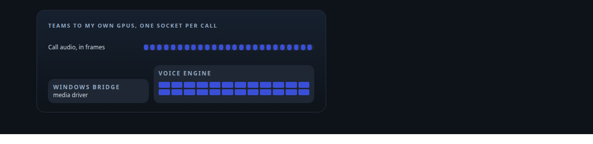
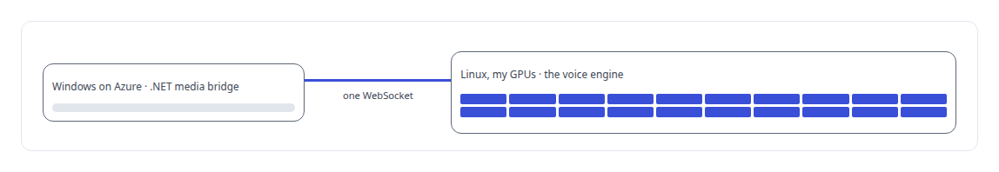
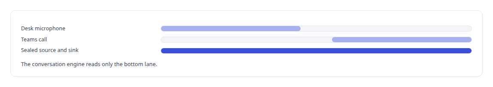
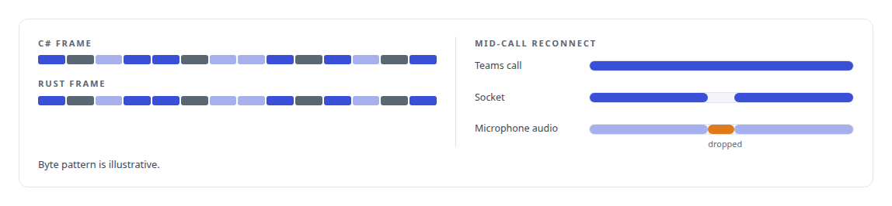

# WebSocket

**One authenticated WebSocket per call carries the binary audio link between Teams and my voice engine, and survives a mid-call reconnect.**

Canonical: https://coreyjames.ai/technologies/websocket/  
Author: Corey James · Published: 2026-10-28 · Kind: technology  
Systems: [Helix](https://github.com/coreyjames-ai/helix)  
Skills: [Rust systems engineering](https://github.com/coreyjames-ai/portfolio/tree/main/skills/rust-systems-engineering) · [Microsoft Teams real-time media](https://github.com/coreyjames-ai/portfolio/tree/main/skills/microsoft-teams-real-time-media) · [inference serving architecture](https://github.com/coreyjames-ai/portfolio/tree/main/skills/inference-serving-architecture) · [distributed systems correctness](https://github.com/coreyjames-ai/portfolio/tree/main/skills/distributed-systems-correctness)  



## Result

| Figure | What it measures |
| --- | --- |
| **2** | implementations held to byte-identical output |
| **20 ms** | audio pacing the media SDK expects |
| **30 min** | soak with a forced mid-call reconnect |

## What was built

### A media driver on Windows, the intelligence on my side

[Helix](https://coreyjames.ai/systems/helix) answers Microsoft Teams calls with a voice engine on my own GPUs under Linux, and Teams hands raw call audio only to a Windows application built on Microsoft's real-time media SDK. I kept all intelligence on my side and made the Windows piece a media driver, joined to the engine by a WebSocket link carrying a binary media protocol I designed.



### One socket per call, admitted by identity

Each call gets one authenticated, full-duplex secure WebSocket between the bridge and the engine, so a call's lifetime equals its socket's. On the Linux side an Axum endpoint admits a session only when its tenant, persona and identity fingerprint match what the engine expects.

It then presents the call as one more implementation of the engine's sealed audio source and sink, the interfaces the local microphone and speaker already use, so the conversation engine runs unchanged whether it is talking to a desk microphone or a Teams call. Audio and video travel as fixed binary frames tagged with their persona and session.



### Two implementations, one set of bytes

I implemented the protocol in C# and in Rust against shared golden test vectors, so a one-byte change on either side fails a test before it reaches a call. On Windows, the SDK's receive callbacks copy their buffer and return at once, as its lifetime rules require, and a paced sender transmits at the SDK's expected rhythm only while the socket is up.

If the link drops, the bridge reconnects inside the same Teams call with fresh credentials and discards microphone audio captured during the gap, because late speech confuses a conversation more than a short silence does. The whole account is [A self-hosted colleague in a Teams call](https://coreyjames.ai/stories/a-self-hosted-colleague-in-a-teams-call). WebSocket is the standard transport; the media protocol, session admission and reconnect behaviour are mine.




> I can design a real-time protocol across two languages, two clouds and a vendor SDK with strict rules, and prove it under soak and fault before I call it finished.

## What was verified

Each line is a claim the canonical page supports, with the figure as the page states it.

- Microsoft Teams real-time media: one authenticated full-duplex WebSocket per call between a .NET media bridge and a Rust voice engine, admitted by tenant, persona and fingerprint.
- Binary protocol design: 2 implementations, C# and Rust, held to byte-identical output with shared golden vectors, audio paced at 20 ms.
- Fault tolerance in real-time systems: a 30 min soak and a forced reconnect inside the same call, with audio from the gap dropped.

## Related

- [A self-hosted colleague in a Teams call](https://github.com/coreyjames-ai/helix/tree/main/stories/a-self-hosted-colleague-in-a-teams-call) · https://coreyjames.ai/stories/a-self-hosted-colleague-in-a-teams-call/
- System: [Helix](https://github.com/coreyjames-ai/helix)

## Citation

Corey James. "WebSocket." coreyjames.ai, 2026. https://coreyjames.ai/technologies/websocket/

```bibtex
@misc{coreyjames-websocket,
  author = {Corey James},
  title = {WebSocket},
  year = {2026},
  howpublished = {\url{https://coreyjames.ai/technologies/websocket/}},
  note = {GitHub copy: https://github.com/coreyjames-ai/portfolio/tree/main/technologies/websocket}
}
```

Part of [Corey James's portfolio](https://github.com/coreyjames-ai/portfolio) · site: https://coreyjames.ai/ · MCP server: https://coreyjames.ai/mcp · agent card: https://coreyjames.ai/.well-known/agent.json
