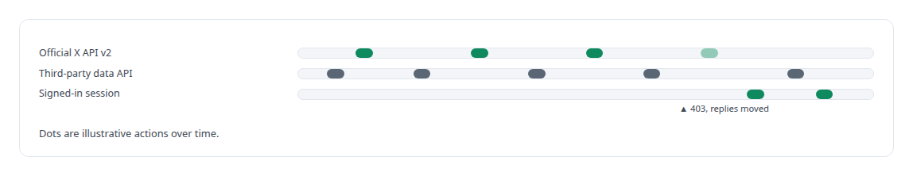
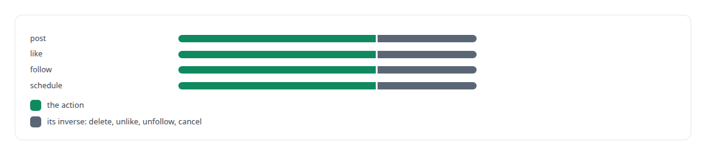
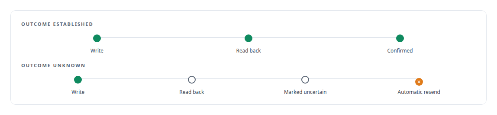

# X API

**An in-house X integration where one service owns the rate limit, the monthly budget and the send log, and never re-sends an action whose outcome is unknown.**

Canonical: https://coreyjames.ai/technologies/x-api/  
Author: Corey James · Published: 2026-10-28 · Kind: technology  
Systems: [FAFOHive](https://github.com/coreyjames-ai/fafohive)  
Skills: [tool synthesis and governed API integration](https://github.com/coreyjames-ai/portfolio/tree/main/skills/tool-synthesis-and-governed-api-integration) · [exactly-once delivery and crash recovery](https://github.com/coreyjames-ai/portfolio/tree/main/skills/exactly-once-delivery-and-crash-recovery) · [distributed systems correctness](https://github.com/coreyjames-ai/portfolio/tree/main/skills/distributed-systems-correctness) · [inference serving architecture](https://github.com/coreyjames-ai/portfolio/tree/main/skills/inference-serving-architecture)  


## Result

| Figure | What it measures |
| --- | --- |
| **36** | tools in the integration |
| **21** | reading and analysis tools |
| **15** | action tools, each with an inverse |

## What was built

### Routes chosen from measured behaviour

[FAFOHive](https://coreyjames.ai/systems/fafohive) needed an X integration that AI agents could use for research and replies without burning a metered budget or posting twice. I built it behind the same governed tool gateway as every other tool, with the same identity, attribution and audit, on two programmatic routes: the official X API v2, and a third-party X data API that costs less for public research. A third route, the operator's own signed-in session, covers actions the official API does not allow here.

The official API goes through an allow-listed transport with OAuth 2.0 and PKCE for user context, and its Activity webhooks are checked before ingestion. Routing is fixed per action, chosen from measured platform behaviour. When the official API returned 403 for replies to some targets, I moved replies and quotes to the signed-in session and wrote the decision down, so behaviour never depends on which call happened to fail.



### Tools shaped as jobs

Reading and acting sit on two separately authorised endpoints with separate credentials, so read access never grants the right to act. I generated a one-tool-per-endpoint surface first and threw it away. The read tools are jobs instead: find fresh conversations on a topic, profile a list of accounts in one batched call, find accounts similar to an audience through the cheap identifiers-first route, measure a hashtag's activity, report on one's own posts.

The action tools post, reply, quote, schedule, follow, like and send direct messages.



### One owner for the budget and the send log

One service owns the shared rate limit, a monthly usage budget with reservations, the cache and a durable log of sends, so concurrent agents, the scheduler and the poller cannot each spend the full allowance. Every tool description states its cost formula and every result returns what it cost; the server enforces the budget. Every successful API response is kept, scrubbed of credentials, for later analysis without paying twice. The gateway itself is in [Agents with real tools and no keys](https://coreyjames.ai/stories/agents-with-real-tools-and-no-keys).

Each write is read back, and a write whose outcome cannot be established is never resent automatically.




X's APIs and the data service are theirs; the workflow tools, routing, budget control and send durability are mine.

> A duplicated public post is worse than a missing one.

## What was verified

Each line is a claim the canonical page supports, with the figure as the page states it.

- Tool synthesis and governed API integration: an X integration of 36 tools, 21 for reading and 15 for actions, with read and act on separately authorised endpoints.
- Rate limiting and budget control: one service owns the rate limit, a monthly budget with reservations and a durable send log, and every result states its cost.
- Exactly-once delivery: every write read back, and a write whose outcome is unknown never resent automatically.

## Related

- [Agents with real tools and no keys](https://github.com/coreyjames-ai/fafohive/tree/main/stories/agents-with-real-tools-and-no-keys) · https://coreyjames.ai/stories/agents-with-real-tools-and-no-keys/
- System: [FAFOHive](https://github.com/coreyjames-ai/fafohive)

## Citation

Corey James. "X API." coreyjames.ai, 2026. https://coreyjames.ai/technologies/x-api/

```bibtex
@misc{coreyjames-x-api,
  author = {Corey James},
  title = {X API},
  year = {2026},
  howpublished = {\url{https://coreyjames.ai/technologies/x-api/}},
  note = {GitHub copy: https://github.com/coreyjames-ai/portfolio/tree/main/technologies/x-api}
}
```

Part of [Corey James's portfolio](https://github.com/coreyjames-ai/portfolio) · site: https://coreyjames.ai/ · MCP server: https://coreyjames.ai/mcp · agent card: https://coreyjames.ai/.well-known/agent.json
