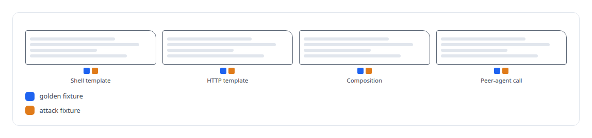
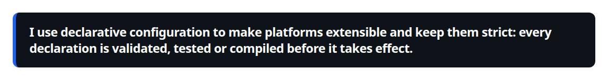

# YAML

**Tools, personas, execution profiles and tool schemas are YAML in my estate, compiled and hash-pinned rather than parsed at runtime.**

Canonical: https://coreyjames.ai/technologies/yaml/  
Author: Corey James · Published: 2026-10-28 · Kind: technology  
Systems: [Agent Swarm](https://github.com/coreyjames-ai/agent-swarm) · [AgentOS](https://github.com/coreyjames-ai/agentos) · [FAFO Core and Function Forge](https://github.com/coreyjames-ai/fafo-core)  
Skills: [tool synthesis and governed API integration](https://github.com/coreyjames-ai/portfolio/tree/main/skills/tool-synthesis-and-governed-api-integration) · [AI-assisted engineering methodology](https://github.com/coreyjames-ai/portfolio/tree/main/skills/ai-assisted-engineering-methodology)  


## Result

| Figure | What it measures |
| --- | --- |
| **40** | tools declared in YAML |
| **545** | lines of schema validating every persona |
| **12,000** | lines of catalog, personas, groundings and profiles |
| **18** | multi-action MCP tools on the control surface |

## What was built

### Tools and agent classes as data

[Agent Swarm](https://coreyjames.ai/systems/agent-swarm) rests on one idea of mine, that tools are the platform, and I wanted adding a tool or an agent class to be a declaration with no new code. The tools are YAML documents of four kinds, each with a Rust dispatcher.

Every tool must ship with golden fixtures that pin its behaviour and attack fixtures that try to break it, such as an injection attempt against a shell template, and the build fails for a tool without them. See [Tools are the platform](https://coreyjames.ai/stories/tools-are-the-platform).



### Personas validated at load

Personas are YAML too: each names a tool subset, a policy, a workspace and a container or execution profile, and a schema validates every one at load time. Grants of tools to roles live in one tool-class manifest, and the persona launcher reads it to decide what each seat may call.

[AgentOS](https://coreyjames.ai/systems/agentos) launches governed seats from the same persona and team definitions. I moved its managed grounding, the standing context each seat receives, out of code into YAML, so policy text changes by edit with no rebuild.


### Schemas that generate dispatch

[FAFO Core and Function Forge](https://coreyjames.ai/systems/fafo-core) exposes its control surface as multi-action MCP tools whose schemas are declarative YAML, about five thousand lines. The server's dispatch code is generated from those files at build time. Function Forge registers newly generated functions through the same files, which is how the toolset extends itself; see [Tools that build tools, under governance](https://coreyjames.ai/stories/tools-that-build-tools-under-governance).


YAML is the notation; the schemas, dispatchers, fixtures and generators give it meaning.



> I use declarative configuration to make platforms extensible and keep them strict: every declaration is validated, tested or compiled before it takes effect.

## What was verified

Each line is a claim the canonical page supports, with the figure as the page states it.

- Declarative tool and agent definition: 40 tools declared as YAML documents of four kinds, each with golden and attack fixtures the build enforces.
- Schema validation: a 545-line schema validating every persona at load time, over about 12,000 lines of catalog, personas, groundings and profiles.
- Code generation from schemas: 18 multi-action MCP tools whose dispatch code is generated from YAML schemas at build time.

## Related

- [Tools are the platform](https://github.com/coreyjames-ai/agent-swarm/tree/main/stories/tools-are-the-platform) · https://coreyjames.ai/stories/tools-are-the-platform/
- [Tools that build tools, under governance](https://github.com/coreyjames-ai/fafo-core/tree/main/stories/tools-that-build-tools-under-governance) · https://coreyjames.ai/stories/tools-that-build-tools-under-governance/
- System: [Agent Swarm](https://github.com/coreyjames-ai/agent-swarm)
- System: [AgentOS](https://github.com/coreyjames-ai/agentos)
- System: [FAFO Core and Function Forge](https://github.com/coreyjames-ai/fafo-core)

## Citation

Corey James. "YAML." coreyjames.ai, 2026. https://coreyjames.ai/technologies/yaml/

```bibtex
@misc{coreyjames-yaml,
  author = {Corey James},
  title = {YAML},
  year = {2026},
  howpublished = {\url{https://coreyjames.ai/technologies/yaml/}},
  note = {GitHub copy: https://github.com/coreyjames-ai/portfolio/tree/main/technologies/yaml}
}
```

Part of [Corey James's portfolio](https://github.com/coreyjames-ai/portfolio) · site: https://coreyjames.ai/ · MCP server: https://coreyjames.ai/mcp · agent card: https://coreyjames.ai/.well-known/agent.json
