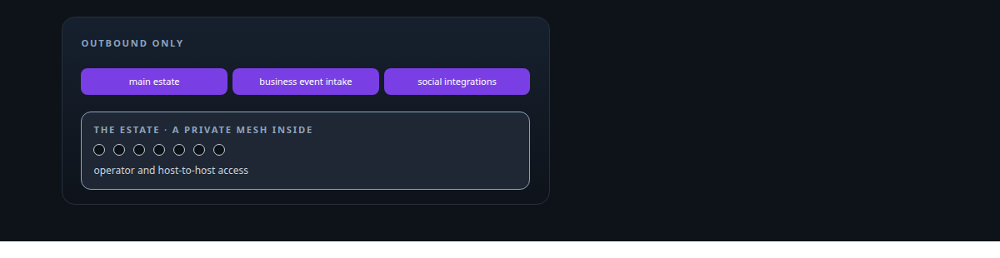
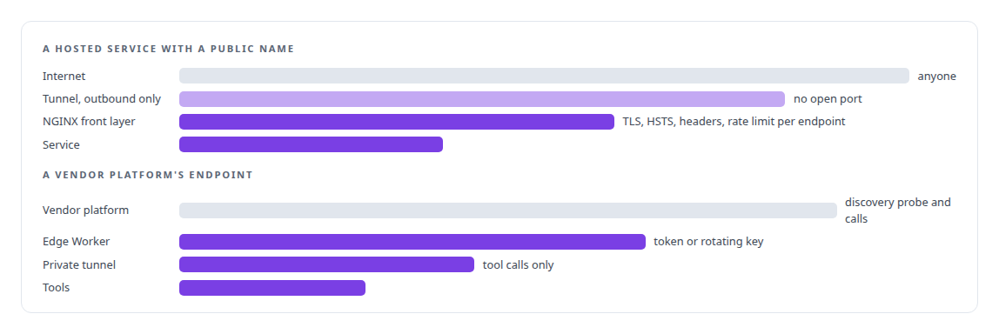
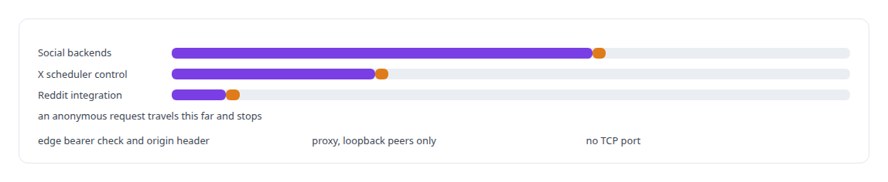
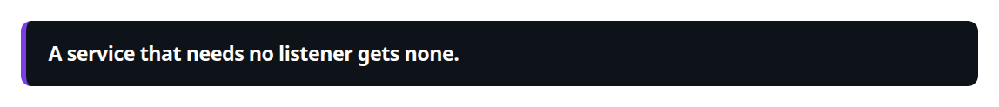
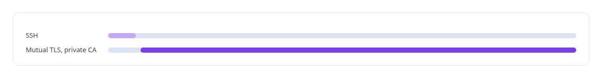

# Zero-inbound network exposure

**No host in my estate accepts an inbound connection. Everything arrives through authenticated tunnels or a private mesh, and every public surface is fronted by TLS and rate limits.**

Canonical: https://coreyjames.ai/technologies/zero-inbound-network-exposure/  
Author: Corey James · Published: 2026-10-28 · Kind: technology  
Systems: [Auth and access plane](https://github.com/coreyjames-ai/auth-and-access-plane) · [Helix](https://github.com/coreyjames-ai/helix) · [FAFOHive](https://github.com/coreyjames-ai/fafohive) · [Inference Fabric](https://github.com/coreyjames-ai/inference-fabric)  
Skills: [zero-trust and zero-inbound networking](https://github.com/coreyjames-ai/portfolio/tree/main/skills/zero-trust-and-zero-inbound-networking)  



## Result

| Figure | What it measures |
| --- | --- |
| **0** | inbound connections from the internet |
| **3** | outbound tunnels, one per purpose |
| **1** | public component in front of a vendor platform: a small edge Worker |

## What was built

### Outbound tunnels, one per purpose

[Auth and access plane](https://coreyjames.ai/systems/auth-and-access-plane) holds my estate to one rule I set early: no service accepts an inbound connection from the internet. Everything public arrives through outbound-only tunnels, one per purpose, separating the main estate, business event intake and the social-platform integrations, so trouble on one surface stays there and I can cut any one surface without touching the others.

Where a hosted service needs a public name, NGINX terminates TLS behind the tunnel, and TLS termination, rate limits and security headers sit in that one front layer. Where a vendor platform such as Microsoft Copilot Studio needs a public endpoint, it reaches the tools through an edge Worker. [Helix](https://coreyjames.ai/systems/helix) exposes its voice endpoint through a tunnel behind an access policy that answers authenticated callers and refuses anonymous ones.



Commercial AI platforms and my own agents reach the estate on my terms. The tunnels, mesh and edge runtime are third-party infrastructure; the exposure design, the per-purpose separation and the edge components are mine.

### Doors the social integrations keep shut

[FAFOHive](https://coreyjames.ai/systems/fafohive) applies the rule to my X, Facebook and Reddit integrations. Their backends are reached only through a tunnel, behind an edge bearer check and an origin header the proxy requires. The timers that wake the X scheduler call a control endpoint that accepts only loopback peers with their own credential, and the proxy blocks that path from outside as well. The Reddit integration has no TCP port at all and is reached through a private Unix socket.





### GPU workstations under certificates

[Inference Fabric](https://coreyjames.ai/systems/inference-fabric) brings LAN GPU workstations under control with no standing shell access: SSH bootstraps a host once, and every later command goes over mutual TLS with my private certificate authority.



> A service that needs no listener gets none.

## What was verified

Each line is a claim the canonical page supports, with the figure as the page states it.

- Zero-trust and zero-inbound networking: 0 inbound connections from the internet; everything public arrives through 3 outbound tunnels, one per purpose.
- Edge security design: 1 small edge Worker as the only public component in front of a vendor platform, and NGINX with TLS, security headers and per-endpoint rate limits elsewhere.
- Mutual TLS for fleet control: LAN GPU workstations bootstrapped by SSH once, then controlled only over mutual TLS with a private certificate authority.

## Related

- System: [Auth and access plane](https://github.com/coreyjames-ai/auth-and-access-plane)
- System: [Helix](https://github.com/coreyjames-ai/helix)
- System: [FAFOHive](https://github.com/coreyjames-ai/fafohive)
- System: [Inference Fabric](https://github.com/coreyjames-ai/inference-fabric)

## Citation

Corey James. "Zero-inbound network exposure." coreyjames.ai, 2026. https://coreyjames.ai/technologies/zero-inbound-network-exposure/

```bibtex
@misc{coreyjames-zero-inbound-network-exposure,
  author = {Corey James},
  title = {Zero-inbound network exposure},
  year = {2026},
  howpublished = {\url{https://coreyjames.ai/technologies/zero-inbound-network-exposure/}},
  note = {GitHub copy: https://github.com/coreyjames-ai/portfolio/tree/main/technologies/zero-inbound-network-exposure}
}
```

Part of [Corey James's portfolio](https://github.com/coreyjames-ai/portfolio) · site: https://coreyjames.ai/ · MCP server: https://coreyjames.ai/mcp · agent card: https://coreyjames.ai/.well-known/agent.json
